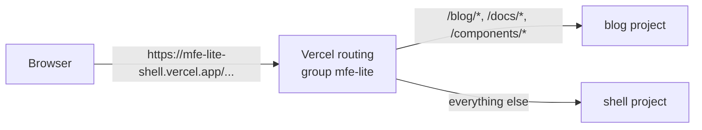
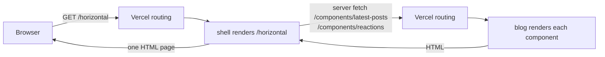
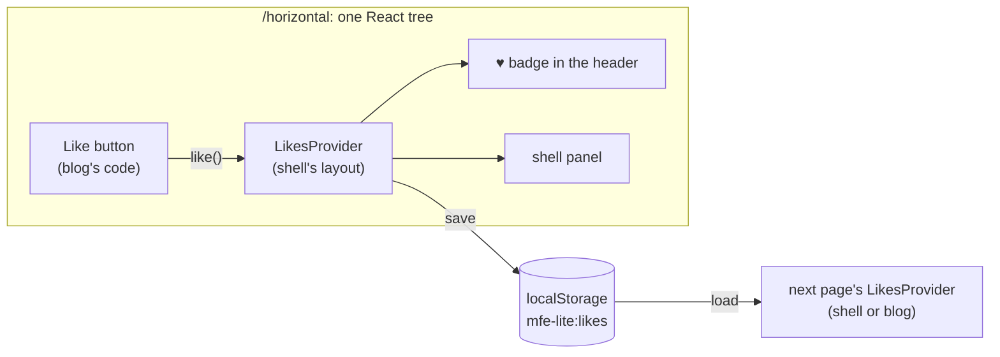

# MFE Lite

The smallest honest demo of [Vercel Microfrontends](https://vercel.com/docs/microfrontends) on the Hobby plan, cost $0.

**Live demo:** https://mfe-lite-shell.vercel.app · **Horizontal page:** https://mfe-lite-shell.vercel.app/horizontal · **Interactive lab:** https://mfe-lite-shell.vercel.app/lab.html

It shows the four things that matter and nothing else. The first three are the **vertical** split, where each path belongs to one app; the fourth is the **horizontal** split, where one page holds pieces from both apps:

1. **One domain** in front of two independently built Next.js apps.
2. **Independent deployments**: each app is its own Vercel project with its own builds, deployments and rollbacks; a failed blog build leaves the shell up.
3. **One routing file**: `microfrontends.json` in the shell lists the paths the blog owns; Vercel applies it before any app code runs.
4. **One page, two deployments**: the shell's `/horizontal` page embeds two components that the blog project builds and deploys. A blog-only deployment changes them without a shell build. A Like pressed in the blog's component writes into a React context that the shell owns ([shared state](#shared-state-between-zones)).

| App | Package | Role | Paths | Vercel project |
|---|---|---|---|---|
| `apps/shell` | `@mfe-lite/shell` | Default app; owns `microfrontends.json`; hosts `/horizontal` | `/` and every path nobody claims | `mfe-lite-shell` |
| `apps/blog` | `@mfe-lite/blog` | Child zone; serves the embedded components | `/blog`, `/blog/*`, `/docs`, `/docs/*`, `/components/*` | `mfe-lite-blog` |

`packages/ui` holds the shared header. Its links use `Link` from `@vercel/microfrontends/next/client`, so a link inside a zone stays a client-side navigation and a link into the other zone becomes a full navigation, and a small badge shows which zone rendered the page. It also holds `@mfe-lite/ui/likes`, the small browser contract both zones use to share a like count.

## Request flow (vertical)



Ownership is decided by Vercel's routing layer before any code runs: `/blog`, `/docs` and `/components` go to the blog project, every other path to the shell. Neither app forwards requests to the other; the shell never sees `/blog` or `/docs`.

Every response carries `x-mfe-zone: shell | blog`, set by each zone's `proxy.ts`, so routing can be checked with curl. That header is the proxies' only job.

## One page, two deployments (horizontal)



- The blog exposes two pages under `/components/*`, a path group it owns in `microfrontends.json`: `latest-posts` (a Server Component, no client JavaScript) and `reactions` (a Client Component with a Like button). Each is wrapped in `ExposeRemoteComponent` from [`remote-components`](https://www.npmjs.com/package/remote-components) (0.4.16, pinned).
- The shell's `/horizontal` page renders its own text and two `ConsumeRemoteComponent` slots. On the server, a relative `src` resolves against `https://$VERCEL_PROJECT_PRODUCTION_URL` in production, so the fetch goes through the same routing and reaches the blog. The page arrives with both components already in the HTML; the Like button then hydrates with JavaScript loaded from the blog's `/vc-ap-<hash>/` prefix.
- The page is rendered per request (`dynamic = "force-dynamic"`), so a blog deployment shows up on the next page load. Each slot sits in an error boundary and `Suspense`: if the blog is down, the page still answers 200 and the slot shows a fallback.
- Each card says `served by: blog`, inside a dashed frame that the shell draws. After a blog-only commit, the shell's deployment is canceled as unaffected and the next request to `/horizontal` shows the changed cards without a shell build (see [EVIDENCE.md](EVIDENCE.md)).

What it costs, measured on production:

- Each embedded component renders inside an open Shadow DOM: its CSS cannot leak into the shell, but `document.querySelector` on the page does not see it.
- The embedded components bring the blog's own JavaScript: 12 files, about 190 KB transferred, roughly as much as the shell's own JavaScript.
- Preview deployments are behind Deployment Protection, and outside production a relative `src` resolves against the branch URL, so `/horizontal` is only demonstrated on production.
- `remote-components` is a 0.x package; its API may still change.

## Shared state between zones



Press Like in the blog's Reactions card on `/horizontal` and the ♥ count in the shell's header and the shell's panel follow at once. All three read one React context, held by the shell.

- **One module, shared.** Both `next.config.ts` files pass `shared: ["@mfe-lite/ui/likes-context"]` to `withRemoteComponentsConfig`. By default `remote-components` shares only `react`, `react-dom` and `next/*`; with this entry the blog's remote lists `packages/ui/src/likes/context.tsx` as a required singleton, and in the browser its import of that module is the shell's live copy. The blog's button finds the shell's `LikesProvider` and calls its `like()`.
- **Each zone has a provider.** Both root layouts render `<LikesProvider owner="…">` around the header and the page. On blog pages the button uses the blog's own provider. The button's `data-store` attribute names the zone whose provider it reached.
- **Across pages: saved, not shared.** A reload or a move between zones is a full page load and a new React tree. The provider saves the count in `localStorage` under `mfe-lite:likes` (both zones are on one origin) and loads it when it mounts; the browser's `storage` event updates other tabs.
- **Tests.** `apps/shell/__tests__/likes.test.ts` renders a provider and a consumer. From the same copy of the module they connect; from two separate copies, which is what each zone bundles without `shared`, the consumer is disconnected.

What is shared and what is only saved:

| Where you look | How it gets the count |
|---|---|
| The same page, both apps (`/horizontal`) | **Shared**: one React context, through `shared`. It updates at once; nothing is stored or sent. |
| Another page, either app | **Saved**: a new page builds a new provider, which loads the count this browser saved. |
| Another tab | **Saved**: the browser's `storage` event tells the other tab to load the saved count again. |
| Another browser or visitor | **Neither**: the demo has no server, so each browser has its own count. |

**In production**, `localStorage` would not be the store. The count would live on a server, behind an API owned by the team that owns the feature (here the blog, for example an `/api/likes` route on a database such as Redis), and the other app would call that API through the shared domain, never the database. Each layout would render the count from the server, so the HTML shows the real number. The shared context would stay as it is: the in-page copy that updates at once when someone presses Like. Only where the provider loads and saves the count would change.

Limits:

- Sharing happens in the browser. The blog renders the remote's server HTML under its own layout; the shell's module takes over when the page loads. The server HTML shows 0 either way.
- The shared module is an API between two deployments: the blog's button runs against the shell's build of `likes-context`. Change its shape (`count`, `like`, `owner`) so that both the old and the new side still work.
- The count is per browser and per origin: the blog project's own domain, `mfe-lite-blog.vercel.app`, keeps its own. A count shared by every visitor would need server-side storage.

## Local workflow

```bash
pnpm install
pnpm dev        # Turborepo starts shell (3000), blog (3001) and the microfrontends proxy on 3024
```

Open http://localhost:3024 (and http://localhost:3024/horizontal). Then:

```bash
curl -sI localhost:3024/                         | grep x-mfe-zone   # shell
curl -sI localhost:3024/blog                     | grep x-mfe-zone   # blog
curl -sI localhost:3024/docs                     | grep x-mfe-zone   # blog
curl -sI localhost:3024/components/latest-posts  | grep x-mfe-zone   # blog
```

Outside Vercel, a relative remote `src` resolves against the local proxy (`http://localhost:3024`), so `/horizontal` needs the proxy running.

```bash
pnpm test        # routing contract and shared-likes tests (apps/shell/__tests__/)
pnpm typecheck
pnpm build
```

`validateRouting` (from `@vercel/microfrontends/next/testing`) checks that each sample path lands in the expected app and that none of the blog's paths falls through to the shell. `unstable_doesMiddlewareMatch` (from `next/experimental/testing/server`) checks that the shell proxy's matcher runs for the shell's paths and skips `/blog`, `/docs`, `/components`, the `vc-ap-*` asset prefix and `_next`.

## Deploy (Vercel Hobby)

1. Create two projects from this repo: `mfe-lite-shell` (Root Directory `apps/shell`) and `mfe-lite-blog` (Root Directory `apps/blog`). Each app's `vercel.json` sets the build command to `cd ../.. && pnpm turbo build --filter=<package>`.
2. Link the repo root to the shell project and create the group (one group of two projects is the Hobby maximum):
   ```bash
   vercel link --project mfe-lite-shell --yes
   vercel microfrontends create-group --name mfe-lite --default-app mfe-lite-shell \
     --project mfe-lite-shell --project mfe-lite-blog --project-default-route mfe-lite-blog=/docs --yes
   ```
3. Connect both projects to the repo (`vercel git connect`, from the repo root and with `--cwd apps/blog`) and push to `main`. Each project builds only its own app (the `--filter` in its build command) and skips commits that do not affect it: a change only under `apps/blog` builds the blog alone, while a change outside the apps, such as a doc at the repo root, builds both. The group composes them on the shell's domain. Deployments built before the group existed must be redeployed once.
   A CLI deploy must also run from the repo root (`vercel deploy --prod --project <name>`): from inside `apps/<app>` the upload lacks the monorepo root and fails with "Root Directory does not exist".

## The four checks

Against the shell's production domain (`$HOST=https://mfe-lite-shell.vercel.app`):

| Check | Command | Expect |
|---|---|---|
| One domain | `curl -sI $HOST/blog \| grep x-mfe-zone`, same for `/docs` | `blog` (shell `/` answers `shell`) |
| Independent deployments | push a change under `apps/blog` only | only the blog builds; the shell's deployment is canceled as unaffected and `/` keeps serving its current deployment; each project keeps its own deployment list and rollback |
| One routing file | `curl -sI $HOST/does-not-exist \| grep -E '^HTTP\|x-mfe-zone'` | `404`, `shell`: nobody claims the path, so the default app answers |
| One page, two deployments | `curl -s $HOST/horizontal \| grep -o 'data-remote="[a-z-]*"'`, then push a change under `apps/blog/app/components` only | both remotes in the HTML; after the blog-only deploy the cards show the change while the shell's deployment is Canceled |

Blog assets load under `/vc-ap-<hash>/_next/...`, the hashed prefix `withMicrofrontends` gives the child zone. Shared state is checked in a browser: press Like on `/horizontal` and the header's ♥ count and the shell's panel follow, with the button's `data-store` set to `shell`; reload, open `/blog/hello-world`, then go back Home, and the count stays. Recorded outputs: [EVIDENCE.md](EVIDENCE.md).

## Gotchas this demo encodes

- The shell's matcher must exclude `_next/`, `vc-ap-` and the child-owned `/blog`, `/docs` and `/components` paths, or the shell shadows the child.
- `withMicrofrontends` injects `MFE_CONFIG`, `NEXT_PUBLIC_MFE_CURRENT_APPLICATION` and the client's copy of the routing table at build time; the shared `Link` reads that copy to tell same-zone links from cross-zone ones.
- Both `next.config.ts` files wrap the config as `withRemoteComponentsConfig(withMicrofrontends(config), { shared })`, with the same `shared` list on both sides.
- A link inside an embedded component is a plain `<a>`: the component does not know which zone the host page belongs to.
- A shared workspace package is bundled once per zone, embedded components included, unless both apps list it in `withRemoteComponentsConfig({ shared })`. Only `@mfe-lite/ui/likes-context` is listed here, so on `/horizontal` the blog's button and the shell use one React context. Across full page loads nothing is shared at runtime: the count is saved in `localStorage`.
- Hobby: one microfrontends group per team, two projects per group. The embedded components come from the blog, not a third project.
- Vercel skips a project that a commit does not affect (`enableAffectedProjectsDeployments`, on for both projects): a change only under `apps/blog` builds only the blog. A change outside the apps, even a doc at the repo root, builds both, and a commit with no file changes builds neither.

## Learn more

- [docs/architecture.md](docs/architecture.md): request flow, the horizontal page, shared state, the two projects and their settings, local vs production.
- [apps/shell/public/lab.html](apps/shell/public/lab.html), live at https://mfe-lite-shell.vercel.app/lab.html: a self-contained interactive lab served by the shell as a static file. It explains how the vertical and the horizontal split are set up and how they work: a vertical/horizontal explorer, a request router you can type any path into, the asset prefix, cross-zone navigation, `/horizontal` assembled step by step (with the blog down and an X-ray view), the shared like count, a blog-only deploy, and a map of every file involved.

## License

[MIT](LICENSE)
