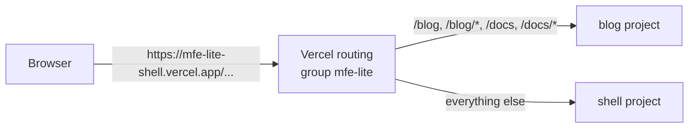

# MFE Lite

The smallest honest demo of [Vercel Microfrontends](https://vercel.com/docs/microfrontends) on the Hobby plan, cost $0.

**Live demo:** https://mfe-lite-shell.vercel.app · **Interactive lab:** https://mfe-lite-shell.vercel.app/lab.html

It shows the three things that matter and nothing else:

1. **One domain** in front of two independently built Next.js apps.
2. **Independent deployments**: each app is its own Vercel project with its own builds, deployments and rollbacks; a failed blog build leaves the shell up.
3. **One routing file**: `microfrontends.json` in the shell lists the paths the blog owns; Vercel applies it before any app code runs.

| App | Package | Role | Paths | Vercel project |
|---|---|---|---|---|
| `apps/shell` | `@mfe-lite/shell` | Default app; owns `microfrontends.json` | `/` and every path nobody claims | `mfe-lite-shell` |
| `apps/blog` | `@mfe-lite/blog` | Child zone | `/blog`, `/blog/*`, `/docs`, `/docs/*` | `mfe-lite-blog` |

`packages/ui` holds the shared header. Its links use `Link` from `@vercel/microfrontends/next/client`, so a link inside a zone stays a client-side navigation and a link into the other zone becomes a full navigation, and a small badge shows which zone rendered the page.

## Request flow



Ownership is decided by Vercel's routing layer before any code runs: `/blog` and `/docs` go to the blog project, every other path to the shell. Neither app forwards requests to the other; the shell never sees `/blog` or `/docs`.

Every response carries `x-mfe-zone: shell | blog`, set by each zone's `proxy.ts`, so routing can be checked with curl. That header is the proxies' only job.

## Local workflow

```bash
pnpm install
pnpm dev        # Turborepo starts shell (3000), blog (3001) and the microfrontends proxy on 3024
```

Open http://localhost:3024. Then:

```bash
curl -sI localhost:3024/        | grep x-mfe-zone   # shell
curl -sI localhost:3024/blog    | grep x-mfe-zone   # blog
curl -sI localhost:3024/docs    | grep x-mfe-zone   # blog
```

```bash
pnpm test        # routing contract tests (apps/shell/__tests__/routing.test.ts)
pnpm typecheck
pnpm build
```

`validateRouting` (from `@vercel/microfrontends/next/testing`) checks that each sample path lands in the expected app and that none of the blog's paths falls through to the shell. `unstable_doesMiddlewareMatch` (from `next/experimental/testing/server`) checks that the shell proxy's matcher runs for the shell's paths and skips `/blog`, `/docs`, the `vc-ap-*` asset prefix and `_next`.

## Deploy (Vercel Hobby)

1. Create two projects from this repo: `mfe-lite-shell` (Root Directory `apps/shell`) and `mfe-lite-blog` (Root Directory `apps/blog`). Each app's `vercel.json` sets the build command to `cd ../.. && pnpm turbo build --filter=<package>`.
2. Link the repo root to the shell project and create the group (one group of two projects is the Hobby maximum):
   ```bash
   vercel link --project mfe-lite-shell --yes
   vercel microfrontends create-group --name mfe-lite --default-app mfe-lite-shell \
     --project mfe-lite-shell --project mfe-lite-blog --project-default-route mfe-lite-blog=/docs --yes
   ```
3. Connect both projects to the repo (`vercel git connect`, from the repo root and with `--cwd apps/blog`) and push to `main`. Each project builds only its own app (the `--filter` in its build command) and skips commits that do not affect it: a change only under `apps/blog` builds the blog alone, while a change outside the apps, such as a doc at the repo root, builds both. The group composes them on the shell's domain. Deployments built before the group existed must be redeployed once.
   A CLI deploy must also run from the repo root (`vercel deploy --prod --project <name>`): from inside `apps/<app>` the upload lacks the monorepo root and fails with "Root Directory does not exist".

## The three checks

Against the shell's production domain (`$HOST=https://mfe-lite-shell.vercel.app`):

| Check | Command | Expect |
|---|---|---|
| One domain | `curl -sI $HOST/blog \| grep x-mfe-zone`, same for `/docs` | `blog` (shell `/` answers `shell`) |
| Independent deployments | push a change under `apps/blog` only | only the blog builds; the shell's deployment is canceled as unaffected and `/` keeps serving its current deployment; each project keeps its own deployment list and rollback |
| One routing file | `curl -sI $HOST/does-not-exist \| grep -E '^HTTP\|x-mfe-zone'` | `404`, `shell`: nobody claims the path, so the default app answers |

Blog assets load under `/vc-ap-<hash>/_next/...`, the hashed prefix `withMicrofrontends` gives the child zone. Recorded outputs: [EVIDENCE.md](EVIDENCE.md).

## Gotchas this demo encodes

- The shell's matcher must exclude `_next/`, `vc-ap-` and the child-owned `/blog` and `/docs` paths, or the shell shadows the child.
- `withMicrofrontends` injects `MFE_CONFIG`, `NEXT_PUBLIC_MFE_CURRENT_APPLICATION` and the client's copy of the routing table at build time; the shared `Link` reads that copy to tell same-zone links from cross-zone ones.
- Hobby: one microfrontends group per team, two projects per group.
- Vercel skips a project that a commit does not affect (`enableAffectedProjectsDeployments`, on for both projects): a change only under `apps/blog` builds only the blog. A change outside the apps, even a doc at the repo root, builds both, and a commit with no file changes builds neither.

## Learn more

- [docs/architecture.md](docs/architecture.md): request flow, the two projects and their settings, local vs production.
- [apps/shell/public/lab.html](apps/shell/public/lab.html), live at https://mfe-lite-shell.vercel.app/lab.html: a self-contained interactive lab served by the shell as a static file: overview, animated request flow with a path picker, the recorded checks, and an eight-rule cheat sheet for `microfrontends.json`, the proxy matcher and cross-zone links.

## License

[MIT](LICENSE)
